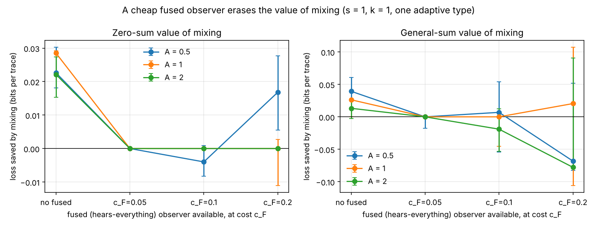
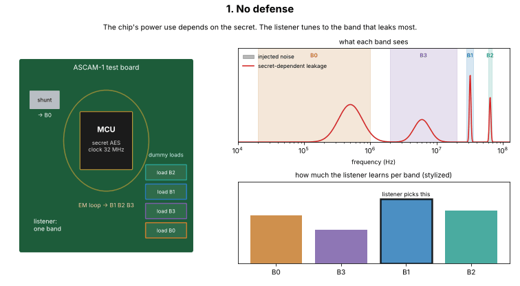
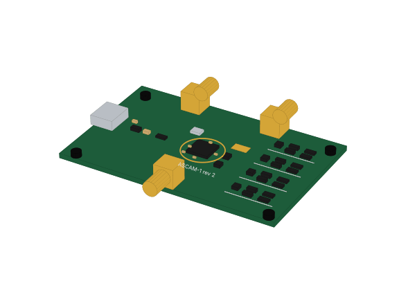

# Game Theory in a Circuit: Can a Chip Hide Its Noise by Playing Smart?

## Why I did this

It started with all the AI and ML buzz at my co-op. During downtime I hung out
with the AI/ML team, watched intro AI lectures, and kept wondering where game
theory could fit into electrical engineering. My first guess was circuits, like
electrons "choosing" paths through wires, but I wanted a corner fewer people had
looked at, so I ended up in signals and side channels.

## Game theory in a nutshell

Game theory is the math of decisions when your best move depends on what someone
else does. You write down who the players are, what each can do, and what each
gets, then look for the moves that nobody wants to change.

## The impala story


*Original pixel art made for this repo (free to reuse). Yes, the red pixel is the tick.*

My favorite example comes from Veritasium's
[What Game Theory Reveals About Life, The Universe, and Everything](https://www.youtube.com/watch?v=mScpHTIi-kM).
Impalas groom each other to get rid of ticks, which they can't reach on their own
necks. But grooming isn't free. It costs time, energy, and saliva, and in the
African heat water is scarce. So every impala faces a choice: groom your
neighbor, or just enjoy being groomed.

Turn that into points and you get the classic **prisoner's dilemma**:

| | Neighbor grooms | Neighbor refuses |
|---|---|---|
| **I groom** | 3, 3 | 0, 5 |
| **I refuse** | 5, 0 | 1, 1 |

If both groom, each gets 3. If both refuse, each gets 1. If I refuse while my
neighbor grooms me, I get 5 and they get 0. Whatever the neighbor does,
refusing pays more for me, yet if both of us think that way we both end up worse
off (1 each instead of 3).

The political scientist **Robert Axelrod** asked what happens when the game is
played over and over. He ran a computer tournament of strategies, and the winner
was one of the simplest: **Tit for Tat**. Start nice, then copy whatever the
other player did last round.

```python
C, D = "groom", "refuse"
PAYOFF = {(C, C): (3, 3), (D, D): (1, 1), (D, C): (5, 0), (C, D): (0, 5)}

def tit_for_tat(my_moves, their_moves):
    return their_moves[-1] if their_moves else C   # start nice, then copy

def always_refuse(my_moves, their_moves):
    return D

def play(a, b, rounds=10):
    ma, mb, sa, sb = [], [], 0, 0
    for _ in range(rounds):
        x, y = a(ma, mb), b(mb, ma)
        pa, pb = PAYOFF[(x, y)]
        ma.append(x); mb.append(y); sa += pa; sb += pb
    return sa, sb

print(play(tit_for_tat, tit_for_tat))     # (30, 30): two nice players thrive
print(play(tit_for_tat, always_refuse))   # (9, 14): gets burned once, then stops
```

The full version is in [`software/examples/tit_for_tat.py`](software/examples/tit_for_tat.py).

## So how does this connect to EECS and signals?

Every chip leaks a little. When it computes, its power draw and RF emissions
change slightly depending on the data, including secret data like a key. Someone
with a probe or an antenna can listen to that noise. This is called a **side
channel**.

That is a game with two players:

- **The device (defender)** can shuffle its clock frequency (hopping) and add
  dummy noise in different frequency bands. Each trick costs energy and time.
- **The listener (observer)** picks which frequency band to listen to, and it
  adapts: it picks the band that leaks the most against whatever the device does.

The score is how much the listener learns, measured in bits per trace (mutual
information), plus the energy and time the device spends. Unlike the impalas,
this game is closer to rock-paper-scissors: if the device always does the same
thing, the listener learns where to listen. So the real question is whether
**randomizing** the defense beats picking one fixed defense.

## What I set out to do

My question: *can a device shuffle its clock and dummy power draw so that a
smart listener learns less, without burning too much energy?*

I tried to answer it in simulation first, before buying any hardware:

1. Build a simulator where a device leaks a synthetic secret bit into four
   frequency bands, with a knob `s` for how differently the defenses affect each
   band (0 = every band reacts the same, 1 = fully band-specific).
2. Let an adaptive listener pick the best band against each defense.
3. Solve for the best randomized defense with linear programming, and compare it
   with the best single fixed defense and with simpler optimizers.
4. Check every number fairly: fit on half the data and score on the other half,
   bootstrap the uncertainty, and compare against exact math.

All secrets are synthetic and nothing here touches real or third-party devices.

## What we did and what we found

**Step 1: a tiny 4 x 4 version.** Four defenses (none, fixed dummy load, random
frequency, both) against four listening bands. Result: the best plan is one fixed
defense ("both"). Randomizing adds exactly nothing here.

**Step 2: a richer four-band model.** 213 possible defenses (hop or not, and how
to spread the dummy noise over the bands at three power levels), tested across
400 settings of leakage strength, the band knob `s`, energy price, and listener
types. Each setting uses 128 sessions of 1,000 traces per cell.

**Step 3: score it fairly.** A strategy chosen on the same data it is scored on
always looks good. So I fit each strategy on one half of the sessions and score it
on the other half, then bootstrap 1,000 times for 95% confidence intervals.

**Step 4: first finding.** Against the 213-option menu, randomizing beats the best
fixed defense in 96 of 400 settings. That looked exciting.

**Step 5: the reality check.** Maybe randomizing only wins because the menu is too
coarse, and some "in between" fixed defense would do just as well. So I built a
much finer menu of **36,402** fixed defenses and computed the exact answer. Now
randomizing wins by more than 0.002 bits in only **27 of 400** settings, by at
most about **0.05 bits per trace**. An earlier, independent version of this code
got almost the same answer (29 settings, max 0.051). As a controlled check I also
reran this code with that version's physics: it reproduces the original study
(29 vs 28 significant settings, identical exact-model counts, the same defenses
picked), so the result does not hinge on one implementation.


*How much randomizing beats the best fixed defense (red = helps). It only shows up
on the right side (separable bands, `s` of 0.5 or more) and at stronger leakage.
At `s = 0` it is exactly zero everywhere.*

**Step 6: what if the listener hears everything?** The math predicts that a
listener who captures all four bands at once (and combines them) leaves nothing
to hide behind. I added that listener with its own capture cost. When it is cheap,
randomizing helps in only **3 of 108** settings instead of 55. When the capture is
expensive, the listener uses it less and some of the benefit comes back.



**Step 7: make the game fair to both sides.** In the first version, the device
"won" whenever the listener paid for an expensive band, which is not realistic.
Now each side counts only its own costs: the device pays energy and time, the
listener pays for its equipment. In this version, committing to a strategy first
(being a Stackelberg leader) actually matters. It beats the old policy in 29 of
108 settings, and by up to 0.17 bits per trace when an expensive wideband capture
exists. One catch: a strategy that only works by making the listener *barely*
prefer one band falls apart on new data, so the commitment needs a safety margin.
Details: [`software/results/EXTENSIONS_RESULTS.md`](software/results/EXTENSIONS_RESULTS.md).

**Step 8: design a board to measure `s` for real.** Everything depends on the band
knob `s`, so I designed a small test board (USB powered, about 23 USD in parts)
with four dummy loads, each aimed at one listening band, plus a current shunt and
a printed EM pickup loop. Its SPICE simulation caught a real design flaw first:
switching the loads on and off at random dumped noise into the low band and
dropped `s` to **0.17**. Adding a "balanced" twin load that keeps the average
current constant brought it back to **0.78**, inside the range where randomizing
can help. The schematic, simulation, parts list, 3D model, and measurement plan
are in [`hardware/`](hardware/README.md).





## My conclusion

- **Randomizing is real, but small and picky.** It helps in about 7% of settings,
  and only by a few percent.
- **It needs separable bands.** If every band reacts the same way to the
  defense, one fixed defense is always best (I can prove this one: with only one
  effective listening option, the math always picks a single fixed defense).
- **A smarter listener erases it.** In simulation, a cheap listener that hears all
  bands at once cuts the settings where randomizing helps from 55 to 3 of 108.
  So the answer depends on what kind of eavesdropper you expect.
- **Committing first matters once the game is fair.** When each side counts only
  its own costs, a committed strategy beats the old one, but it needs a safety
  margin to survive real (noisy) measurements.
- **A real board can probably reach the needed separability.** The test board's
  simulation says about 0.78 after one design fix, but only a measurement settles
  it.
- **Honest takeaway:** game theory changed the answer only in a narrow corner.
  That is still useful. It tells a designer when randomizing is worth the effort
  and when a single well-tuned defense is enough.

Everything above is simulation with made-up channel numbers, and the board exists
only as a design so far. The next steps are capturing the board in KiCad, building
it, measuring `s` and the clock-hop coupling, and putting the measured numbers back
into the simulator.

Full numbers, confidence intervals and all five figures:
[`software/results/VALUE_OF_GAME_RESULTS.md`](software/results/VALUE_OF_GAME_RESULTS.md).
The fused listener and the fair (general-sum) game:
[`software/results/EXTENSIONS_RESULTS.md`](software/results/EXTENSIONS_RESULTS.md).
The test board: [`hardware/README.md`](hardware/README.md).
The math (model, proofs, open questions):
[`theory/model-and-proof-roadmap.md`](theory/model-and-proof-roadmap.md).
Related work: [`paper/related-work-nearest-table.md`](paper/related-work-nearest-table.md).

## How you can use this repo

- **Try the tool.** `ascam` (in `software/`) makes a synthetic dataset,
  solves the defender/eavesdropper game, and draws the figures in three
  commands. See the "Command-line tool (ascam)" section of
  [`software/README.md`](software/README.md).
- **Learn game theory with real code.** `software/src/games.py` solves zero-sum
  games, Bayesian games with several player types, and robust versions as linear
  programs. Swap in your own payoff matrix (the impala game works too).
- **Measure leakage.** `software/src/metrics.py` has TVLA (Welch t-test), binned
  mutual information with bias correction, and exact Gaussian-mixture MI for
  checking your estimator.
- **Check a defense before building it.** Plug in your own defense options and
  costs, run the sweep, and see whether randomizing is worth the energy before
  you spend money on hardware.
- **Reuse the board design.** The SPICE netlist (`hardware/spice/`) and the
  share-matrix script show how to check whether a noise injector really stays in
  its frequency band, before you build anything.
- **Copy the honest-evaluation recipe.** Cross-fitting, session bootstrap, exact
  checks, and a finer baseline menu. They are the reason the headline went from
  "96 wins" to "27 small wins", and they apply to any "does my fancy method beat
  the simple one?" question.

## Run it yourself

```bash
cd software
python -m pip install -r requirements.txt
python -m pytest                       # 42 tests, under a minute
python examples/tit_for_tat.py         # the impala game
python -m src.run_experiment --seed 126 --output results/baseline.json
python -m src.run_sweep --quick        # smoke test, seconds
python -m src.run_sweep --seed 126     # full study, about 15 minutes on 4 cores
python -m src.run_extensions --seed 126  # fused listener + fair game, about 25 minutes
cd ..
python hardware/scripts/run_spice.py   # board simulation (needs ngspice)
```

More detail is in [`software/README.md`](software/README.md) and
[`software/RUN_VALUE_STUDY.md`](software/RUN_VALUE_STUDY.md).

## What this is not

This is defensive research code. It does not attack third-party devices, recover
keys from products, or help anyone eavesdrop. All secrets are synthetic, and a
low leakage score from this code is not a security guarantee.

License: MIT (see [`LICENSE`](LICENSE)).
