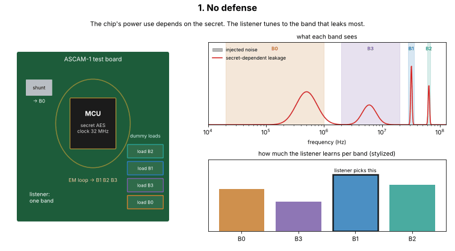
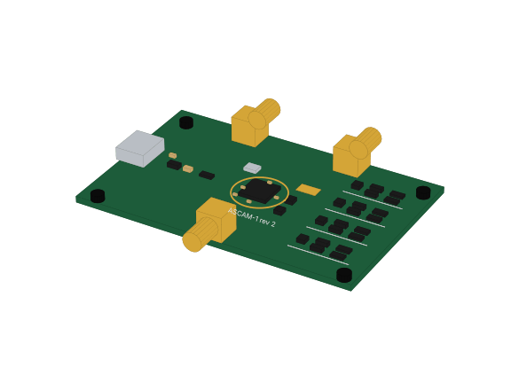
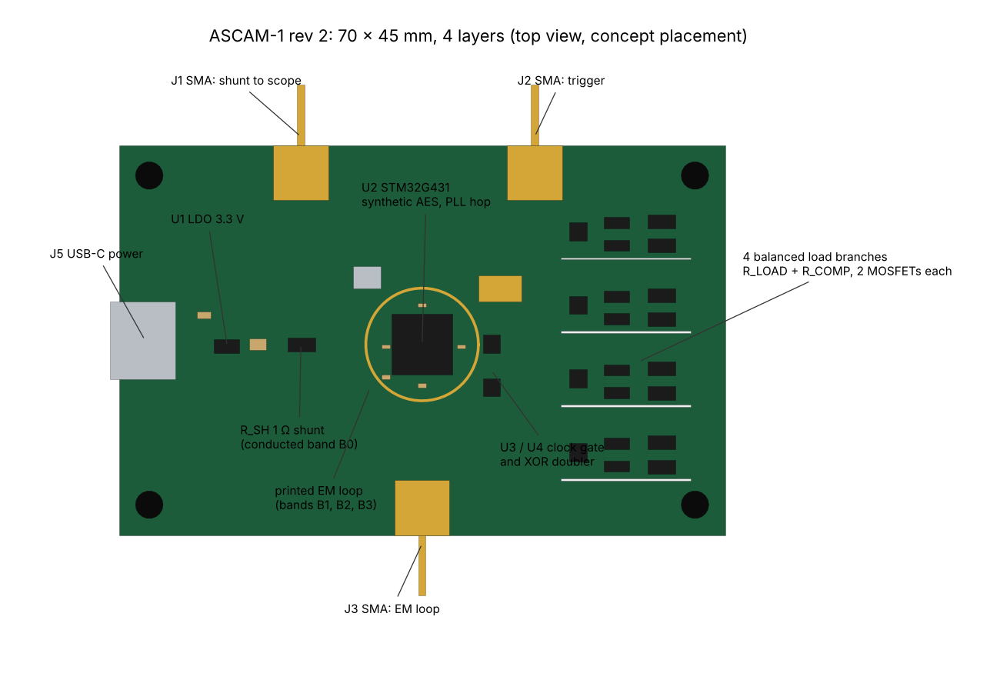
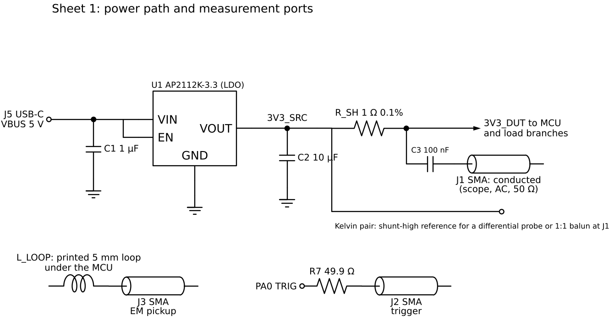
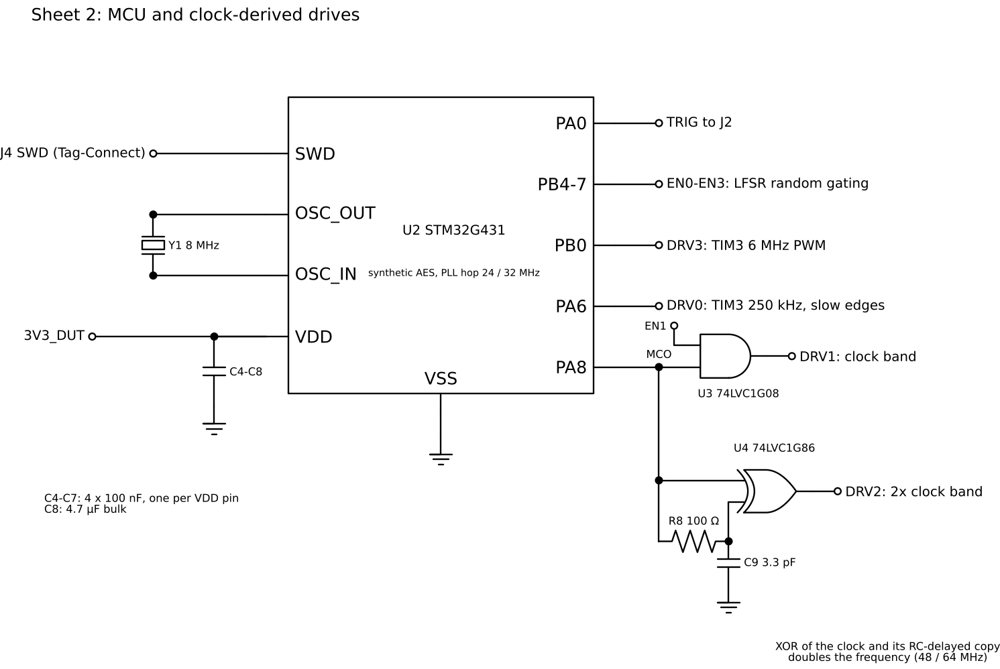
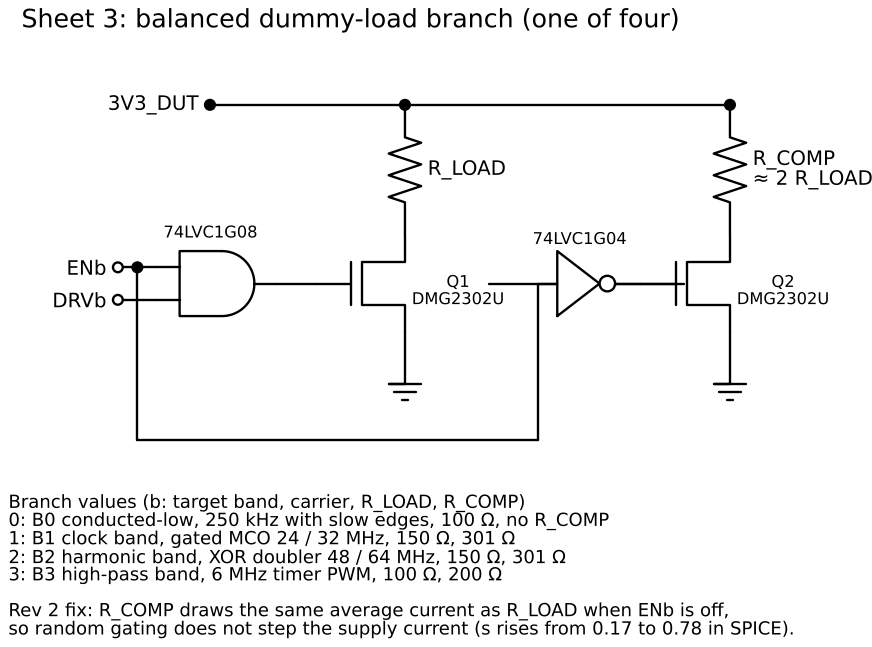
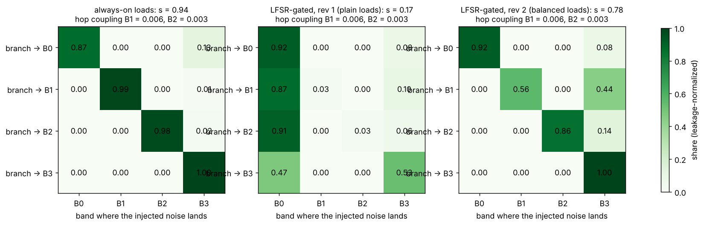
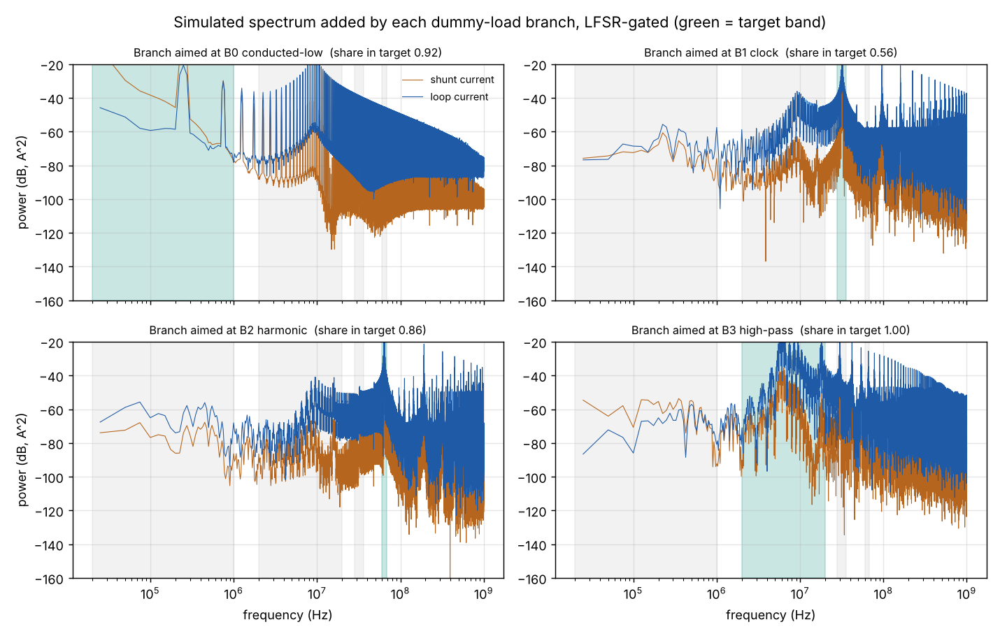

# ASCAM-1: a test board for measuring band separability

Status: **design and simulation only.** Nothing has been built yet. The schematic,
SPICE model, parts list, 3D model, and a pin-checked KiCad netlist are a feasible
first design. PCB layout in KiCad, review, and fabrication are the next steps (see
[`kicad/README.md`](kicad/README.md)).



## Why this board exists

The simulation says randomizing a defense only helps when the bands are
**separable**: when a defense can change one frequency band without spilling into
the others (the knob `s` in the model; mixing needs roughly `s >= 0.5`). Nobody has
measured `s` on real hardware, and it decides whether the effect exists at all.
This board is built to measure it on a device I own, with synthetic secrets only.

It does that with four **dummy-load branches**, each aimed at one listening band,
and two measurement ports that match the model's observers:

| Model band | Board band | Frequency range | Measured at |
|---|---|---|---|
| A0 / B0 conducted-low | supply current | 20 kHz to 1 MHz | 1 ohm shunt, SMA J1 |
| A3 / B3 high-pass | board current | 2 to 20 MHz | printed EM loop, SMA J3 |
| A1 / B1 clock | clock fundamental | 28 to 36 MHz | printed EM loop, SMA J3 |
| A2 / B2 harmonic | 2x clock | 60 to 68 MHz | printed EM loop, SMA J3 |

Clock hopping (the MCU's PLL switches between 32 and 24 MHz) moves the clock lines
out of B1 and B2, which is the model's "hop" defense.





## Schematic

Three sheets. Values match `spice/ascam_board.cir` and `bom.csv`.





- **Power and sensing:** USB-C 5 V, a 3.3 V LDO, then a 1 ohm 0.1% shunt with Kelvin
  pads. Everything after the shunt (MCU and loads) is the device under test, so
  the shunt sees all of its current.
- **MCU:** STM32G431 running synthetic AES. Its MCO pin outputs the system clock;
  an AND gate turns that into the clock-band load drive, and an XOR with an RC-delayed
  copy doubles it for the harmonic band. Two timer channels drive the low and mid
  bands. Four GPIOs carry the random on/off bits (an LFSR in firmware).
- **Balanced load branch (x4):** a MOSFET switches `R_LOAD` with the band's carrier.
  When the random bit turns the branch off, a second MOSFET switches in `R_COMP`,
  which draws the same average current. Why that matters is the main result below.
- **EM loop:** a 5 mm loop printed under the MCU, routed to SMA J3. It makes the
  "near-field probe" position repeatable, which hand-held probes are not.

## Simulation results (ngspice)

`scripts/run_spice.py` simulates 8 cases per design variant (secret 0 and 1, each
branch alone, clock hopped; 24 runs in total) and measures band power the way the bench will: B0 from the
shunt, B1 to B3 from the decoupling-loop current that the EM loop picks up.
Separability uses the model's definition: a branch aimed at band b puts a share
`(1 - s)/4 + s` of its noise (relative to that band's leakage) into band b.

| Design | s | Weakest branch | Hop coupling in B1 / B2 |
|---|---|---|---|
| Loads always on (ideal, periodic) | 0.94 | B0: 0.83 | 0.006 / 0.003 |
| Rev 1: loads gated at random, plain | **0.17** | B1 and B2: below 0 | 0.006 / 0.003 |
| Rev 2: loads gated at random, balanced | **0.78** | B1: 0.41 | 0.006 / 0.003 |



What this says:

1. **Random gating is the real defense, and it nearly destroyed separability.**
   Each on/off step of a load changes the board's average current, the shunt sees
   those steps as low-frequency noise, and every branch ends up mostly in B0.
   That is exactly the "real injectors leak broadband energy" risk the theory
   flagged, caught before building anything.
2. **Balanced loads fix most of it.** Keeping the average current constant raises
   `s` from 0.17 to 0.78, which is inside the regime where the simulation says
   randomizing helps (s of 0.5 or more).
3. **Clock hopping works as the model assumes** for B1 and B2 (coupling near 0,
   versus 0.15 assumed in the model) and does not touch B0 and B3 (coupling 1.0).
4. **Next fix:** the clock-band branch still spills into B3 (s = 0.41) from its
   gating edges. Gating on carrier-synchronous boundaries or slowing the gate edges
   should help. That is rev 3.

These are ideal-part simulations. Board parasitics, real MOSFET switching, and
probe coupling will lower `s`. Only a measurement settles it.



## Measuring s on the real board

Equipment: an oscilloscope with at least 200 MHz bandwidth and FFT (or an SDR that
covers 20 kHz to 70 MHz), SMA cables, a DC block for J1, optionally a 20 dB LNA.
No hand-held probe is needed because the EM loop is on the board.

1. Flash firmware that runs synthetic AES with a GPIO trigger on J2, a fixed
   random key, and commands to enable each branch and the clock hop.
2. Leakage per band: capture traces with secret bit 0 and 1 (no loads), take the
   power of the mean difference in each band, from J1 for B0 and J3 for B1 to B3.
3. Injection per band: enable one branch at a time with random gating on, and
   measure the added power in each band.
4. Run the same share-matrix math as `scripts/run_spice.py` to get the measured
   `s`, and compare leakage with and without the hop to get the hop coupling.
5. Put the measured `s` and coupling into `software/src/band_channel.py` and rerun
   the sweep. That turns "mixing helps in a corner of the simulation" into "mixing
   does or does not help on this board."

Use synthetic keys and test firmware only, on hardware you own. The board is
USB-powered, emits only through its own SMA ports, and has no intentional radiator.

## Feasibility

- **Cost:** about 23 USD in parts per board (`bom.csv`, 64 parts) plus about 10 to 30 USD for
  five 4-layer boards at common PCB fabs.
- **Assembly:** all parts are standard SMD (smallest 0402 and UFQFPN-48). Hand
  assembly with a stencil and hot plate is realistic; fab assembly is easier.
- **Layout rules:** layer 2 solid ground; keep the shunt, J1, and their Kelvin pair
  short and symmetric; place each load branch near the MCU's supply pins so its
  current shares the path the EM loop sees; keep the 32 MHz MCO trace short.
- **Build vs buy:** the board only builds what is not for sale (balanced, band-aimed
  loads plus repeatable sensing). Scope, LNA, and cables are bought or borrowed.

## Files

| Path | What |
|---|---|
| `spice/ascam_board.cir` | SPICE netlist; tested in ngspice 42, written in plain syntax that LTspice also reads (not yet opened in LTspice) |
| `scripts/run_spice.py` | Runs all cases in ngspice, computes s and hop coupling, draws figures |
| `sim/spice_results.json` | Numbers behind the table above |
| `scripts/draw_schematic.py` | Draws the three schematic sheets (schemdraw) |
| `scripts/board_3d.py` | 3D concept model, top view, rotating GIF, STL export |
| `cad/ascam1_board.stl` | 3D model for any STL viewer (mm) |
| `scripts/how_it_works_gif.py` | The explainer animation at the top (stylized, not data) |
| `kicad/ascam1.net` | KiCad netlist (64 parts, 40 nets), import into the PCB editor |
| `kicad/make_netlist.py` | Generates the netlist, `kicad/NETLIST.md`, and `bom.csv` from one parts table, checking every pin against the official KiCad libraries |
| `kicad/README.md` | Step-by-step KiCad 10 guide: import, stackup, placement, layout rules |
| `bom.csv` | Parts list with footprints and rough prices (generated) |

Regenerate everything (needs ngspice on PATH plus `pip install -r hardware/requirements.txt`):

```bash
python hardware/scripts/run_spice.py
python hardware/scripts/draw_schematic.py
python hardware/scripts/board_3d.py
python hardware/scripts/how_it_works_gif.py
```
