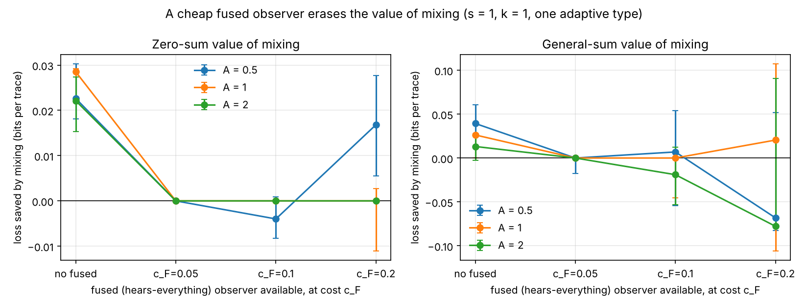
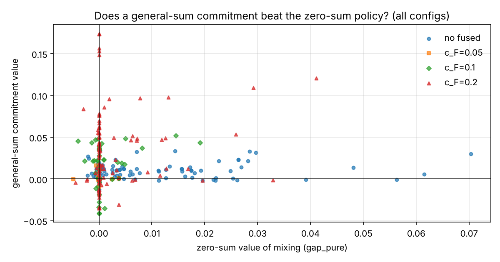

# Extensions: a fused observer and a general-sum game

Status: computed (simulator 0.3.0, seed 126, `python -m src.run_extensions`).
All 432 configs are in `results/extensions_tables.md`. Same synthetic four-band
channel, library, cross-fitting, and session bootstrap as the main study
(`VALUE_OF_GAME_RESULTS.md`), with B = 150 replicates and 128 sessions x 1000
traces per cell. Seed streams: `SeedSequence(126, spawn_key=(2000, i_A, i_s))`.

Grid: A in {0.5, 1, 2}, s in {0, 0.5, 0.75, 1}, k in {0.3, 1, 3}, three observer
type models (1 type, 2 types, 3 types adaptive 0.5), and the fused observer
either absent or available at cost c_F in {0.05, 0.1, 0.2}. 108 configs per
fused setting.

## 1. The fused ("hears everything") observer

**Question.** Theorem P1 says that if the observer effectively has one action,
a single fixed defense is optimal. A listener that captures all four bands at
once and combines them is the physical version of that. Does it erase the value
of mixing?

**Model.** A fifth observer action sees all four bands of the same trace (one
secret and one clock-hop event per trace, independent noise per band) and sums
the per-band log-likelihood ratios, using the deployed row's channel parameters
at median session factors. It is available only to the adaptive type, at its own
cost c_F (the single-band costs are 0.00 to 0.05).

**Result: yes, when it is cheap.**

| Fused observer | Zero-sum gap_pure CI above 0 | Max gap_pure | Fused share of B5 responses |
|---|---|---|---|
| not available | 55 of 108 | 0.070 | 0 |
| c_F = 0.05 | 3 of 108 | 0.004 | 0.66 |
| c_F = 0.10 | 5 of 108 | 0.019 | 0.46 |
| c_F = 0.20 | 21 of 108 | 0.041 | 0.16 |

- At c_F = 0.05 the value of mixing falls from 55 significant configs to 3, and
  its largest size from 0.070 to 0.004 bits per trace.
- As the fused capture gets more expensive, the observer uses it less and the
  value of mixing partly returns.
- At s = 0 no config is significant in any setting, as before.
- This is numerical support for P1 and for target T6 in the theory roadmap. It
  is not a proof.

So the practical value of randomizing depends on what kind of listener you
expect. A band-committed listener leaves room for mixing; a wideband,
multi-channel capture mostly removes it.

**Estimator caveat.** Averaged over the library rows, the fused statistic
learns 0.01 to 0.14 bits more than the best single band, depending on the
dataset. At A = 2 and s = 0, though, its worst row is 0.012 bits below the best
single band. The reason is that the combination uses
median session factors and 16 bins, so it is not exactly optimal.

## 2. The general-sum game

**Question.** In the zero-sum loss `MI + overhead - c_a`, the defender is
credited when the observer pays for an expensive band. Committing first adds
nothing in a zero-sum game (Korzhyk et al. 2011). With each side counting only
its own costs, does commitment (a real Stackelberg leader) change anything?

**Model.**
- defender loss `L[d, a] = MI[d, a] + overhead[d]`
- observer utility `U[d, a] = MI[d, a] - c_a`

Each observer type best-responds to the committed policy by U, with ties going
toward more leakage. The strong Stackelberg policy is found with one LP per
response profile. The induced response must win by a margin (0.01 bits) so
that it survives estimation noise.

Three quantities (defender loss against best-responding types, cross-fitted):

| Quantity | Meaning |
|---|---|
| `gs_gap_pure` | best fixed defense minus the general-sum commitment (value of mixing, general-sum) |
| `commitment_value` | zero-sum policy minus the general-sum commitment, both scored in the general-sum game |
| `gs_gap_pure_tiny_margin` | the same as `gs_gap_pure` with a 0.0001-bit margin |

| Fused observer | gs_gap_pure CI above 0 | commitment value CI above 0 | max commitment value | tiny margin: CI below 0 |
|---|---|---|---|---|
| not available | 41 of 108 | 29 of 108 | 0.034 | 11 of 108 |
| c_F = 0.05 | 3 | 2 | 0.016 | 0 |
| c_F = 0.10 | 4 | 9 | 0.052 | 3 |
| c_F = 0.20 | 8 | 25 | 0.174 | 8 |

- **Commitment now matters.** The general-sum commitment beats the zero-sum
  policy (scored in the general-sum game) at 29 of 108 configs without a fused
  observer, by up to 0.034 bits. Its largest effect, up to 0.17, is when a fused
  observer exists but is expensive. In that case the zero-sum policy steers the
  observer toward the costly capture, because the zero-sum loss rewards the
  defender for the observer's cost. A defender who only cares about leakage and
  its own overhead should not do that.
- **The value of mixing survives in the general-sum game** (41 of 108 without a
  fused observer), but it is noisier than in the zero-sum game.
- **Induced responses are fragile.** With a near-zero margin, the commitment that
  looks best in-sample often loses on held-out sessions (11 configs significantly
  below 0). It relies on making the observer barely prefer one band, and sampling
  noise flips that. The 0.01-bit margin was chosen on an exploratory seed (3),
  not on seed 126. Robust commitment against estimated payoffs is a real design
  requirement, not a detail.

## 3. What changed in the claims

- "Stackelberg" is now justified in the general-sum version: commitment changes
  the policy and the loss. It is still a numerical result on a synthetic channel.
- The practical value of randomizing is conditional on the listener: it holds
  for band-committed listeners and mostly vanishes against a cheap wideband
  capture.
- Both statements still depend on separability. The hardware design in
  `hardware/README.md` estimates s = 0.78 for its rev 2 board in simulation;
  only a measurement settles it.

## 4. Seeds, config, versions

Seed 126; B = 150; 128 sessions x 1000 traces; 16 bins; general-sum margin 0.01
bits (tiny variant 0.0001). Runtime 1393 s on 4 workers. Python 3.13, NumPy 2.5,
SciPy 1.18 (HiGHS). `python -m pytest`: 42 passed.
